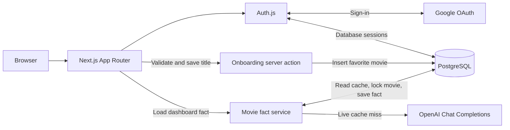
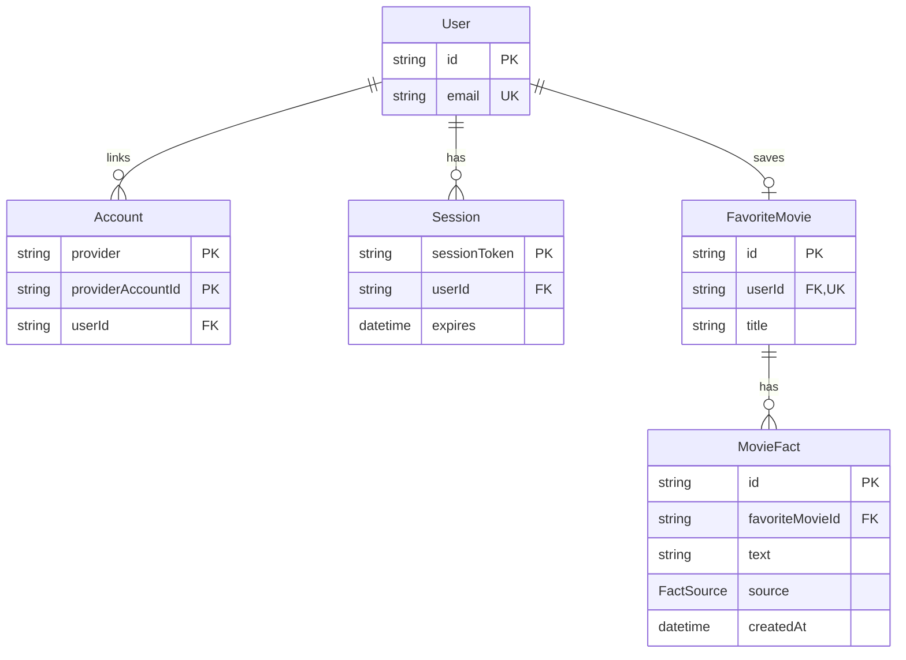

# Movie Memory

Movie Memory is a full-stack app for saving a favorite movie and discovering a fact about it. It uses Next.js App Router, React, TypeScript, Tailwind CSS, PostgreSQL, Prisma, Google OAuth through Auth.js, and the OpenAI Chat Completions API.

## Local setup

1. Install Node.js 24 or newer and start Docker with Compose. Install project dependencies and create the local environment file:

   ```sh
   npm ci
   cp .env.example .env
   openssl rand -base64 32
   ```

   Copy the generated value into `AUTH_SECRET` in `.env`.

2. In Google Auth Platform, create a **Web application** OAuth client and register `http://localhost:3000/api/auth/callback/google` as an authorized redirect URI. Set `AUTH_GOOGLE_ID` and `AUTH_GOOGLE_SECRET` in `.env`. If the OAuth app is in testing, add the Google account you plan to use as a test user.
3. Keep `FACT_MODE=live` and set `OPENAI_API_KEY` to your OpenAI API key. The sample uses `gpt-5.4-mini` with the OpenAI API. Change `OPENAI_MODEL` if your project uses another Chat Completions model.
4. Start PostgreSQL and apply the database migration using the commands below.
5. Run `npm run dev` and open [Movie Memory](http://localhost:3000). Sign in with Google, save a favorite movie, and check that its fact appears on the dashboard.

### Environment variables

| Variable | Required | Purpose |
| --- | --- | --- |
| `DATABASE_URL` | Yes | PostgreSQL connection string. The example matches the local Docker Compose database. |
| `AUTH_SECRET` | Yes | Random secret used by Auth.js. |
| `AUTH_GOOGLE_ID` | Yes | Google OAuth client ID. |
| `AUTH_GOOGLE_SECRET` | Yes | Google OAuth client secret. |
| `FACT_MODE` | Optional | Defaults to `live`. Set it to `demo` to use labeled sample facts for **Interstellar**, **Arrival**, and **Jurassic Park** without an OpenAI API key. |
| `OPENAI_API_KEY` | Live mode | API key for the OpenAI project. |
| `OPENAI_MODEL` | Live mode | Chat Completions model ID available to the OpenAI project. |
| `OPENAI_BASE_URL` | Optional | Defaults to `https://api.openai.com/v1`, also set in the sample. |

Keep credentials in the Git-ignored `.env` file. Demo mode still uses Google OAuth and PostgreSQL. Titles outside its three samples show an unavailable message.

### Database migration

```sh
docker compose up -d --wait
npm run db:migrate
```

The migration command runs `prisma migrate deploy`, which applies the checked-in migrations to the database configured by `DATABASE_URL`. It can be rerun to apply pending migrations. If you already have a PostgreSQL server, set `DATABASE_URL` to the intended database and run only the migration command.

## Variant A: Backend-Focused

I chose Variant A because I’m most interested in building reliable backend systems. At Infosys, I worked on PostgreSQL-backed services and improved API performance through caching, concurrency, and asynchronous processing. My more recent work on authenticated Node.js APIs and AI integrations made this a natural fit. Movie Memory gave me a small, concrete problem to apply those interests to: serve a fact quickly, prevent overlapping requests from generating it twice, and keep the dashboard usable when a provider fails.

## Architecture overview



### Authentication and onboarding

The Next.js App Router renders the landing page, onboarding, and dashboard. Auth.js handles Google OAuth and stores sessions in PostgreSQL through the Prisma adapter. The landing page routes a signed-in user to onboarding if they have no favorite movie, or directly to the dashboard if they do. Onboarding and the dashboard require a valid session, and the onboarding server action checks the session again before writing.

The server trims the movie title and accepts 1–120 characters. It derives the owner from the authenticated session, and PostgreSQL enforces one favorite movie per user through a unique constraint. The insert skips duplicates atomically, so simultaneous or repeated submissions preserve the first title. On the dashboard, a missing name becomes “Movie fan” and a missing photo becomes an initial. Signing out invalidates the session.

### Data model and ownership



| Model | Responsibility |
| --- | --- |
| `User`, `Account`, `Session` | Store the user profile, linked OAuth identity, and expiring database sessions. |
| `FavoriteMovie` | Stores the title and a unique owner ID. Two users can save the same title as separate records. |
| `MovieFact` | Stores fact text, source, and creation time for a specific favorite movie. A composite index on movie, source, and creation time supports reading the latest fact. |

The dashboard derives the movie and its facts from the session user ID. The fact lookup uses the owned movie record, so a shared title or an ID supplied in the URL cannot select another user’s history. Live and demo facts have separate cache entries. Prisma manages the schema and migrations, and database and provider credentials are read only by server code.

After applying the migrations, run `npx prisma studio` to explore the local database and its relationships.

### Cache, concurrent refreshes, and provider failures

1. **Read the cache.** The fact service queries the newest fact for the user’s movie and active source. A fact younger than 60 seconds is returned immediately. At exactly 60 seconds it expires, and the next request attempts to refresh it.
2. **Coordinate generation.** On a miss, a PostgreSQL transaction locks the owned movie row using `SELECT … FOR UPDATE`. After obtaining the lock, the request queries the latest fact again under Read Committed isolation. Another request may have saved a fresh fact while this one waited. If so, it reuses that fact. Otherwise it calls OpenAI, stores the result, and commits.
3. **Recover from a failed call.** The OpenAI SDK sends the movie title and generation instructions from the server. It has an eight-second timeout and automatic retries are disabled. The service rejects empty, incomplete, oversized, or `UNKNOWN` responses. On failure, it releases the lock and looks up the most recent saved fact for the same movie and source, even if that fact has expired. Its original timestamp is preserved, so a later request can retry. If there is no saved fact, the dashboard shows a friendly unavailable message.

The dashboard shows a loading state while the fact is fetched. It renders Markdown and math, skips raw HTML, and displays descriptions for images in generated text.

## Key tradeoffs

- **PostgreSQL doubles as the cache.** The stored history and index cover the access pattern without a second service. Each dashboard request still makes a database read.
- **A row lock coordinates app instances.** Instances sharing PostgreSQL use the same lock, and different movies can generate independently. A transaction holds a connection while OpenAI responds, and waiting refreshes can occupy more connections. The provider call, lock wait, and transaction have time limits.
- **An older fact keeps the dashboard useful during an outage.** Preserving its timestamp lets a later request retry immediately. Repeated requests during a sustained outage can therefore trigger sequential retries.
- **A single model call keeps generation simple.** The service checks whether the response is usable, but it does not verify the trivia against a source.

## What I’d improve with two more hours

- Add inline favorite movie editing with server-side validation, an optimistic update, and rollback on failure. I’d make fact lookup specific to the saved title or its version so a fact for the previous movie cannot appear under the new one.
- Add timing and outcome metrics for cache hits, lock waits, provider failures, and stale fallbacks. I’d use those measurements to decide whether the row lock or retries during outages need a different design.

## Verification

With Docker running and dependencies installed:

```sh
npm run lint
npm run typecheck
npm run build
npm test                         # Cache boundary, authorization, concurrency, and recovery
npx playwright install chromium  # One-time browser setup
npm run test:e2e                 # Onboarding, dashboard, formatting, profile, and logout
```

Each test suite starts a disposable PostgreSQL database, applies the migrations, and uses a local fake model endpoint. The suites use seeded Auth.js database sessions and require no external API credentials. Run them one at a time because they share the Next.js build directory.

For a live smoke check, sign in with Google and verify onboarding with an account that has no saved movie. Save a title and confirm a fact appears in live mode. Sign out, verify that `/dashboard` redirects to sign-in, then sign in again and check that the same account goes directly to the dashboard.

## AI usage

- I used Codex to break down the assignment, compare ways to prevent duplicate fact generation, and work through what should happen when the model times out. I chose Variant A and decided to keep the cache and concurrency guard in PostgreSQL.
- After reviewing each plan, I used Codex to draft and revise code, tests, and documentation. The automated tests checked the 60-second cutoff, user isolation, concurrent refreshes, and recovery from provider failures.
